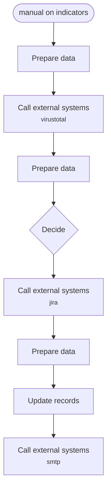
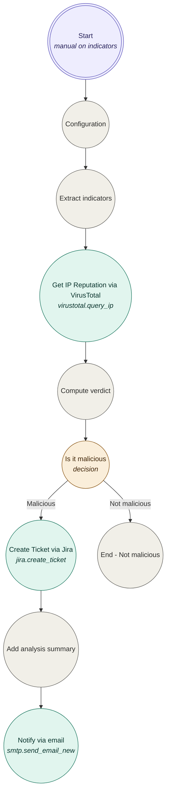
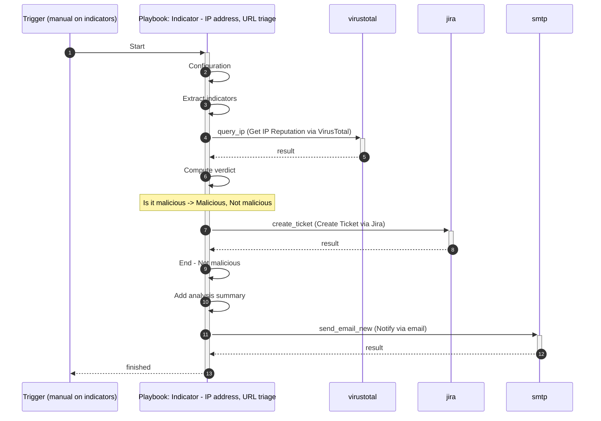

# Indicator - IP address, URL triage

_Playbook design document · version 1 · 2026-10-12_

## 1. Summary

i want to develop a playbook whihc when executed will create. ticket in jira and create a task in fortisaor attached to the aler tor incident record triggered on. the ticket shoudl be created basedo n tehmandatory feild in jora mapped to the alert ot incidnet record data.once created the task shoudl be updated with ticket id and respective data and shoudl be put into in progress. a playbook on schgeduler to check every 15 mins the ticket closure status , on closure detection, it updates the ticket with new details and marks it compelte, and send an email to soc team. if open no updayts, if while creating ticket it fails , the task is makrked as failed too.

- **Runs:** Manual (button on the record) on **Indicator** records
- **Investigates:** IP address, URL
- **Systems involved:** VirusTotal, Jira, SMTP
- **Human approval:** no

## 2. Flow at a glance

## 3. Detailed workflow

## 4. Sequence

## 5. Step by step

| # | Step | What it does | System |
|---|---|---|---|
| 0 | Configuration | Holds every environment-specific value | FortiSOAR |
| 1 | Extract indicators | Reads the indicators from the record (fields set in Configuration) | FortiSOAR |
| 2 | Get IP Reputation via VirusTotal | Get IP Reputation | VirusTotal |
| 3 | Compute verdict | Counts sources reporting the indicators as malicious and writes a summary | FortiSOAR |
| 4 | Is it malicious | Branches on the result | FortiSOAR |
| 5 | Create Ticket via Jira | Creates a Jira ticket on your configured Jira server based on the project key, ticket summary, type, and description, and other input parameters you have specif | Jira |
| 6 | Add analysis summary | Updates the triggering record | FortiSOAR |
| 7 | Notify via email | Send Email | SMTP |

## 6. Safety controls

- **Approval:** none (actions are automatic).
- **Error handling:** every connector step continues on error; the verdict and summary record each source's status.
- **Configuration first:** all environment-specific values live in one Configuration step.
- **Safe import:** the playbook is imported **inactive**; activate it after the staging test.
- **No secrets:** credentials stay in the connector configurations; nothing is hard-coded.

## 7. Prerequisites

| Connector | Version | Operations |
|---|---|---|
| VirusTotal | 3.0.2 | Get IP Reputation |
| Jira | 2.0.0 | Create Ticket |
| SMTP | 2.4.3 | Send Email |

**Configuration values to set after import** (Configuration step):

| Name | Value | Purpose |
|---|---|---|
| `ip_field` | value | Field on the indicators record that holds the IP address |
| `url_field` | value | Field on the indicators record that holds the URL |
| `notify_to` | **REQUIRED** | Recipients / channel for notifications |
| `notify_from` | **REQUIRED** | Sender address for notification email |
| `jira_config` | _blank = default_ | jira connector configuration ID (blank = the connector's default configuration) |
| `smtp_config` | _blank = default_ | smtp connector configuration ID (blank = the connector's default configuration) |
| `virustotal_config` | _blank = default_ | virustotal connector configuration ID (blank = the connector's default configuration) |
| `jira_project_key` | **REQUIRED** | Project Key for jira.create_ticket |
| `jira_ticket_summary` | **REQUIRED** | Ticket Summary for jira.create_ticket |
| `jira_ticket_description` | **REQUIRED** | Ticket Description for jira.create_ticket |
| `jira_issue_type` | **REQUIRED** | Ticket Type for jira.create_ticket |

## 8. Test plan (staging)

1. Import the JSON (Automation → Playbooks → Import) into a **staging** FortiSOAR; check the connectors above are installed and configured.
2. Fill in the Configuration step; assign the approver team on the approval step.
3. Create a test indicator with a **known-bad** test indicator and confirm: enrichment runs, the verdict is *Malicious*, the approval appears, the response action runs on a test object only, the record is updated and the notification arrives.
4. Create a test indicator with a **known-good** indicator and confirm it takes the benign path.
5. Break one connector (e.g. wrong configuration) and confirm the playbook still finishes and reports the failed source.
6. Activate in production; watch the first runs in the Executed Playbook Logs.

## 9. Rollback and support

- To undo response actions on a record, run *Rollback - Indicator - IP address, URL triage* from it — not available for these connectors; undo the actions in the product console.
- To stop the automation, deactivate the playbook; nothing else depends on it.

## 10. Quality review

Automated best-practice review: **100/100, grade A — Approve**.

- [info] Active state is intentional: Exported as inactive.

Before production, the reviewer's manual checklist must be completed: tested in staging, owner and failure notification set, matches the documented use case, rollback plan agreed.

## 11. Version history

| Version | Date | Changed by | Summary of changes |
|---|---|---|---|
| design 1 | 2026-10-12 10:48 | admin | First design |
| design 2 | 2026-10-12 10:52 | admin | Panel: Moved “Extract indicators” down. |
| design 3 | 2026-10-12 10:53 | admin | Panel: Moved “Extract indicators” up. |
| build 1 | 2026-10-12 10:56 | admin | Developed from design 3: score 100 (A) |
